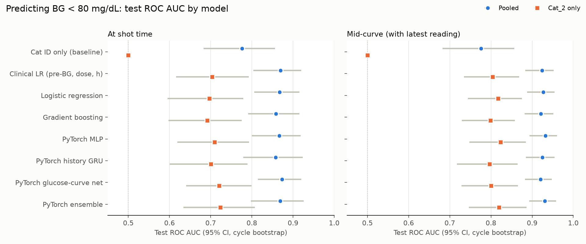
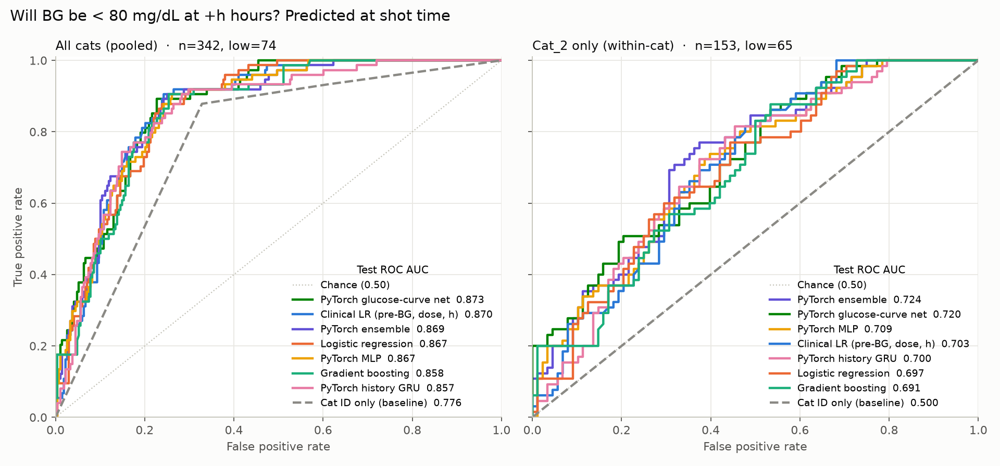
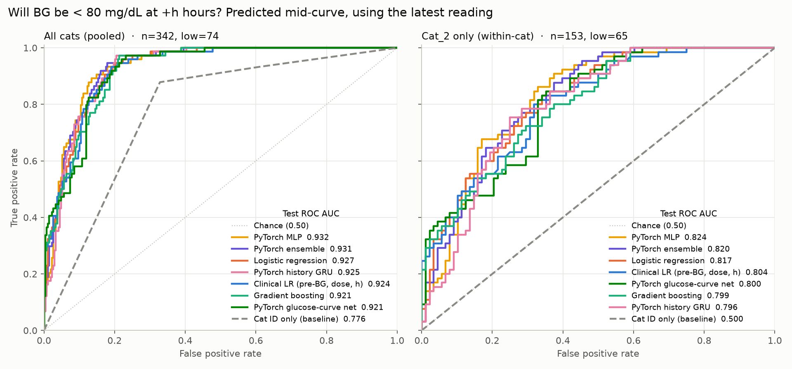

# Feline Diabetes Mellitus: Glucose Curves

Predicting low blood glucose in insulin-treated diabetic cats from home glucose-curve logs.

Each cat's owner logs a blood glucose (BG) reading before every AM and PM insulin shot, plus readings at +1 to +11 hours after the shot. This repo cleans those logs and compares model approaches, mostly PyTorch, for one question:

> **Will this cat's BG be below 80 mg/dL at +h hours after the shot?**

## Results

The task is scored in two settings:

- **At shot time:** uses only what's known when the shot is given: pre-shot BG, dose, AM or PM, and the cat's earlier cycles.
- **Mid-curve:** also uses the most recent reading taken earlier in the same cycle (for example, the +2h reading when predicting +4h).

### Test ROC AUC

| Model | At shot time, all cats | At shot time, Cat_2 only | Mid-curve, all cats | Mid-curve, Cat_2 only |
|---|---|---|---|---|
| Cat ID only (baseline) | 0.776 | 0.500 | 0.776 | 0.500 |
| Clinical logistic regression (pre-shot BG, dose, hour) | 0.870 | 0.703 | 0.924 | 0.804 |
| Logistic regression, all features | 0.867 | 0.697 | 0.927 | 0.817 |
| Gradient boosting | 0.858 | 0.691 | 0.921 | 0.799 |
| PyTorch MLP | 0.867 | 0.709 | **0.932** | **0.824** |
| PyTorch history GRU | 0.857 | 0.700 | 0.925 | 0.796 |
| PyTorch glucose-curve net | **0.873** | 0.720 | 0.921 | 0.800 |
| PyTorch ensemble | 0.869 | **0.724** | 0.931 | 0.820 |

Chosen by validation AUC, the best model at shot time is the **glucose-curve net**, and the best mid-curve model is the **PyTorch ensemble**. Full metrics, including 95% confidence intervals, precision-recall AUC and Brier score, are in [outputs/model_comparison.csv](outputs/model_comparison.csv).



### ROC curves





### What the results show

- **Pooled AUC overstates skill.** Almost all low readings come from Cat_2, so a model that only knows the cat's identity scores 0.78. The **Cat_2-only** AUC is the fairer measure of whether a model has learned anything about glucose.
- **Model choice matters less than inputs.** All approaches land within about 0.02 AUC of each other, and their 95% confidence intervals overlap (about ±0.08 for Cat_2 alone). The PyTorch models don't clearly beat logistic regression on this much data.
- **The latest reading is the strongest input.** Adding it raises the Cat_2-only AUC from about 0.71 to about 0.82 for every model. In practice, an early-curve reading is the best warning of a later low.
- **Summary features capture the history.** The GRU, which reads the previous 6 full curves, adds nothing beyond simple rolling summaries such as the average of recent low points.
- **The per-cat AUCs for Cat_3 and Cat_4 aren't reliable.** Their test slices have only 4 and 5 low readings.

## Data

| Cat | Period | Shot cycles | Readings | Readings < 80 mg/dL | Insulin | Monitoring |
|---|---|---|---|---|---|---|
| Cat_2 | Jan–Sep 2026 | 527 | 1,057 | 379 | Lantus | Meter (FlexMed), TR protocol |
| Cat_3 | Jan–Sep 2026 | 528 | 528 | 13 | Lantus | Meter (ReliOn), SLGS protocol |
| Cat_4 | May–Jun 2025 | 69 | 707 | 17 | Glargine | CGM (FreeStyle Libre 3 Plus), TR protocol |

The raw spreadsheets are in [Cat_CSV/](Cat_CSV/). [fdm/clean.py](fdm/clean.py) turns them into tidy tables:

- Splits half-hour entries. For example, `46 @2.5 45` becomes 46 at +2h and 45 at +2.5h.
- Fixes dose typos such as `2,5` and `2:25`.
- Turns notes such as "No shot," "NS," "Fur shot" and "Late" into `no_shot` and `partial` flags.
- Drops empty and junk cells.

The cleaned data is in [outputs/readings_clean.csv](outputs/readings_clean.csv), with one row per reading, and [outputs/cycles_clean.csv](outputs/cycles_clean.csv), with one row per shot.

## Method

**Inputs** ([fdm/features.py](fdm/features.py)): hours since the shot, pre-shot BG (log scale), dose, dose relative to BG, AM or PM, no-shot and partial-shot flags, hours since the previous shot, dose change, the previous cycle's lowest reading and pre-shot BG, rolling averages over the last 4 cycles, the fraction of recent low readings, and days since the first record. The mid-curve setting adds the latest earlier reading, its time, and the slope from the pre-shot BG. Every history input uses only earlier cycles, so no information leaks from the cycle being predicted.

**Split:** for each cat, the oldest 70% of shot cycles are for training, the next 15% for validation, and the newest 15% for the final test. Settings are tuned and the best model is chosen on validation. The chosen settings are then refit on training plus validation data and scored once on test. Confidence intervals come from a bootstrap that resamples whole shot cycles, because readings within one curve are correlated.

**Models:**

| Model | Description |
|---|---|
| Cat ID only | Logistic regression on cat identity alone; shows how much AUC comes from telling the cats apart |
| Clinical logistic regression | Pre-shot BG, dose and hour only |
| Logistic regression | All features, with regularization tuned on validation |
| Gradient boosting | scikit-learn `HistGradientBoostingClassifier`, learning rate and depth tuned |
| PyTorch MLP | 2-layer MLP with a learned per-cat embedding |
| PyTorch history GRU | GRU over the previous 6 full glucose curves, combined with the current inputs |
| PyTorch glucose-curve net | Predicts the shape of the post-shot curve (depth, timing and width of the low point, plus noise) and trains on the actual BG values as well as the low/not-low labels |
| PyTorch ensemble | Average of the three PyTorch models |

Each PyTorch model is a 5-seed ensemble, trained with AdamW and early stopping.

## Run it

Requires Python 3.10 or later.

```bash
python3 -m venv .venv
.venv/bin/pip install -r requirements.txt
.venv/bin/python run_experiments.py   # about 2 minutes on a laptop CPU
```

Results are written to [outputs/](outputs/).

## Next steps

- **Collect more low readings outside Cat_2.** This would improve the model more than any change to the architecture.
- **Use CGM data where available.** Dense curves like Cat_4's pin down the true low point.
- **Add food intake as an input.** Cat_4's sheet logs it.
- **Calibrate the probabilities before acting on them.** The models rank risk reasonably well, but they haven't been checked as dosing tools.

> Not veterinary advice. Always confirm insulin dosing decisions with your veterinarian.
